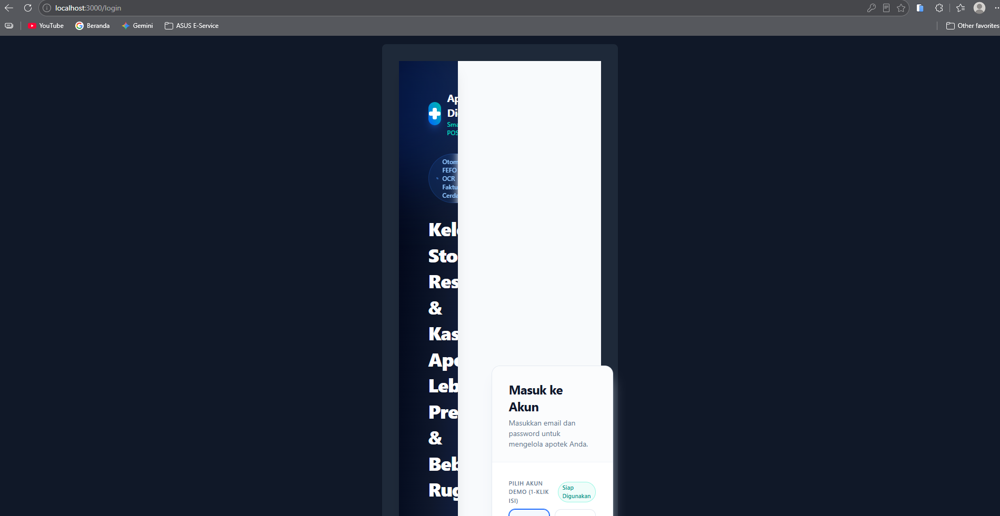
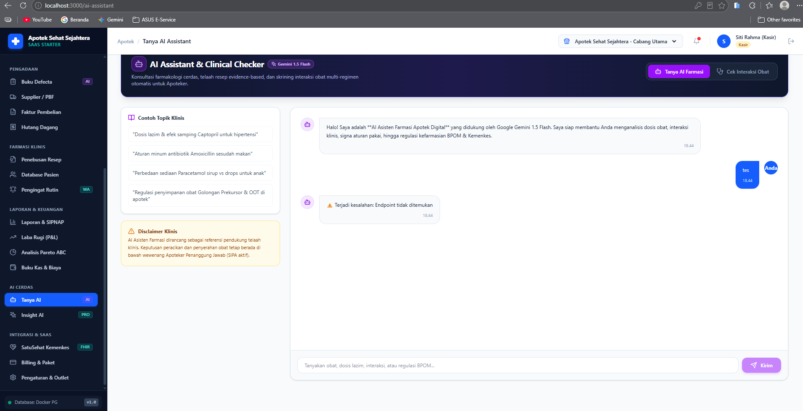
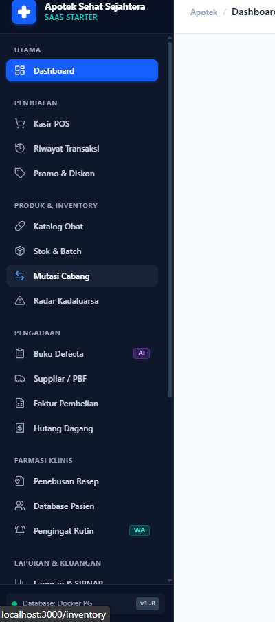

<p align="center">
  
  
  
  
</p>

# 💊 Apotek Digital — Web Dashboard & POS

> Sistem informasi manajemen apotek modern berbasis web dengan fitur Point of Sale (POS), manajemen inventaris FEFO, integrasi AI Gemini, dan kepatuhan regulasi BPOM & Kemenkes RI.

---

## 📸 Screenshots

<p align="center">
  
</p>

<details>
<summary><strong>Lihat screenshot lainnya →</strong></summary>

| Halaman | Preview |
|---------|---------|
| **Kasir POS** |  |
| **Inventaris & Batch** |  |

</details>

---

## ✨ Fitur Utama

### 🏪 Point of Sale (POS)
- Kasir touch-friendly dengan grid katalog obat & pencarian cepat
- Mode resep (Rx) untuk obat keras & narkotika
- Manajemen shift kasir & cash drawer
- Struk digital & cetak thermal printer

### 📦 Inventaris & Stok
- Stok real-time per batch dengan metode **FEFO** (First Expired First Out)
- Radar kadaluarsa otomatis (ED alert)
- Konversi multi-satuan (Box → Strip → Tablet)
- Buku defecta & stock opname
- Transfer stok antar cabang/outlet

### 🏥 Pengadaan & Supplier
- Manajemen distributor PBF (Pedagang Besar Farmasi)
- Input faktur pembelian & tracking hutang dagang (aging)
- Surat Pesanan (SP) digital

### 📊 Laporan & Akuntansi
- Laporan omset harian, fast & slow moving product
- Laporan Laba Rugi (P&L Statement)
- Analisis Pareto ABC inventory
- Pencatatan beban operasional & general ledger kas
- Laporan SIPNAP Kemenkes RI

### 🤖 AI-Powered (Google Gemini)
- **AI Asisten Farmasi** — Tanya jawab farmakologi, dosis, signa, regulasi BPOM
- **Cek Interaksi Obat** — Skrining interaksi multi-regimen otomatis
- **AI Smart Restock** — Rekomendasi pengadaan cerdas berbasis pola konsumsi

### 👥 Pelanggan & CRM
- Database pasien dengan riwayat pembelian (PMR)
- Pengingat obat rutin pasien
- Manajemen promosi & diskon

### 🔗 Integrasi
- **SatuSehat Kemenkes RI** — FHIR R4 MedicationDispense
- Multi-tenant & multi-outlet ready

---

## 🛠️ Tech Stack

| Layer | Teknologi |
|-------|-----------|
| **Framework** | [Next.js 14](https://nextjs.org/) (App Router) |
| **Language** | [TypeScript](https://www.typescriptlang.org/) 5.x |
| **Styling** | [Tailwind CSS](https://tailwindcss.com/) 4.x + Google Stitch Design System |
| **State Management** | [TanStack Query](https://tanstack.com/query) (React Query) |
| **Form** | [React Hook Form](https://react-hook-form.com/) + [Zod](https://zod.dev/) |
| **Icons** | [Lucide React](https://lucide.dev/) |
| **Testing** | [Playwright](https://playwright.dev/) (E2E) |
| **Backend API** | [apotek-digital-api](../apotek-digital-api/) (Hono.js + PostgreSQL) |

---

## 📁 Struktur Project

```
apotek-digital-web/
├── src/
│   ├── app/
│   │   ├── (auth)/                    # Login & Register
│   │   │   ├── login/page.tsx
│   │   │   ├── register/page.tsx
│   │   │   └── forgot-password/page.tsx
│   │   ├── (dashboard)/               # Dashboard modules
│   │   │   ├── dashboard/             # Analitik & KPI
│   │   │   ├── pos/                   # Kasir Point of Sale
│   │   │   ├── products/              # Katalog obat
│   │   │   ├── inventory/             # Stok, batch, radar ED, transfer
│   │   │   ├── transactions/          # Riwayat transaksi
│   │   │   ├── purchases/             # Faktur PBF & hutang
│   │   │   ├── suppliers/             # Distributor PBF
│   │   │   ├── customers/             # Database pasien & PMR
│   │   │   ├── defecta/               # Buku defecta
│   │   │   ├── reports/               # Laporan & SIPNAP
│   │   │   ├── accounting/            # Expenses, P&L, Pareto
│   │   │   ├── prescriptions/         # Resep digital
│   │   │   ├── promotions/            # Promo & diskon
│   │   │   ├── ai-assistant/          # AI Chat & Cek Interaksi Obat
│   │   │   ├── ai-insights/           # AI Smart Restock
│   │   │   ├── satusehat/             # Integrasi FHIR Kemenkes
│   │   │   ├── billing/               # Langganan SaaS
│   │   │   └── settings/              # Pengaturan outlet & user
│   │   ├── globals.css                # Design tokens & Tailwind config
│   │   └── layout.tsx                 # Root layout
│   ├── components/
│   │   ├── layout/                    # Sidebar, Topbar, Navigation
│   │   ├── ui/                        # Reusable UI components
│   │   └── providers.tsx              # React Query & Theme Provider
│   ├── hooks/                         # Custom React hooks
│   ├── lib/                           # API client, utils, constants
│   └── types/                         # TypeScript interfaces
├── tests/                             # Playwright E2E tests
├── public/                            # Static assets
├── .env.example                       # Environment template
├── package.json
├── tsconfig.json
└── postcss.config.mjs
```

---

## 🚀 Getting Started

### Prerequisites

- **Node.js** ≥ 18.x
- **npm** atau **pnpm**
- Backend API running ([apotek-digital-api](../apotek-digital-api/))

### Installation

```bash
# 1. Clone repository
git clone https://github.com/Salman-artz/SaasApotek_Frontend.git
cd SaasApotek_Frontend

# 2. Install dependencies
npm install

# 3. Setup environment variables
cp .env.example .env.local
```

Edit `.env.local`:
```env
NEXT_PUBLIC_API_URL=http://localhost:3001
```

### Development

```bash
# Jalankan development server
npm run dev

# Buka di browser
# http://localhost:3000
```

### Build Production

```bash
npm run build
npm start
```

### Testing (E2E)

```bash
# Install Playwright browsers
npx playwright install

# Run E2E tests
npm run test:e2e

# Run with UI mode
npm run test:e2e:ui
```

---

## 📄 Available Scripts

| Script | Keterangan |
|--------|-----------|
| `npm run dev` | Development server dengan hot reload |
| `npm run build` | Build production optimized |
| `npm start` | Jalankan production build |
| `npm run lint` | Linting dengan ESLint |
| `npm run test:e2e` | Jalankan Playwright E2E test |
| `npm run test:e2e:ui` | Playwright test dengan UI mode |

---

## 🔐 Role-Based Access (RBAC)

| Role | Akses |
|------|-------|
| **Owner** | Full access: dashboard, laporan, akuntansi, pengaturan, AI |
| **Pharmacist** | Kasir POS, inventaris, resep, pelanggan, defecta |
| **Cashier** | Kasir POS, transaksi, pelanggan |

---

## 📝 License

This project is licensed under the MIT License — see the [LICENSE](LICENSE) file for details.

---

<p align="center">
  <sub>Built with ❤️ using Next.js, TypeScript & Tailwind CSS</sub>
</p>
